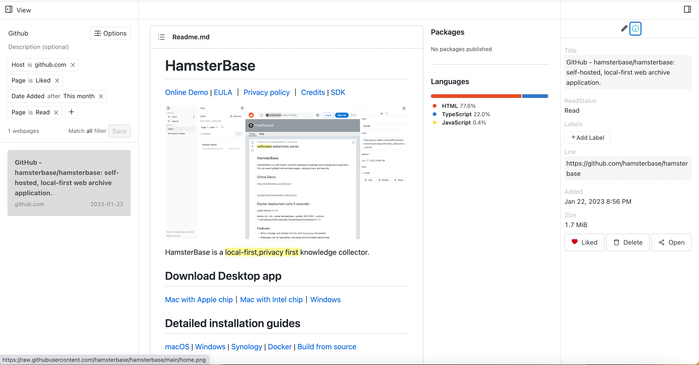

# HamsterBase

[EULA](https://hamsterbase.com/redirect?to=eula) ｜ [Privacy policy](https://hamsterbase.com/redirect?to=privacy) ｜ [Credits](https://hamsterbase.com/redirect?to=credits) | [SDK](https://www.npmjs.com/package/@hamsterbase/sdk)

HamsterBase is a local-first,privacy first knowledge collector.

## Installation

See the [installation guide](https://hamsterbase.com/docs/install/install.html) for download and setup instructions.

## Features

- Store, manage, and preview HTML, [MHTML](https://en.wikipedia.org/wiki/MHTML) and [Webarchive](https://en.wikipedia.org/wiki/Webarchive) documents.
- Webpages can be highlighted, annotated and annotated retroactively.
- Create custom views to filter webpages.
- How to turn views into RSS feed.
- No dependency on any server, all data is local first.
- Full Text Search
- Open source SDK
- Dark Mode

## Faq

### Is HamsterBase open source?

HamsterBase is **not** open source software, it is only distributed through GitHub.

But we have open sourced the SDK, you can find it [here](https://www.npmjs.com/package/@hamsterbase/sdk).

And we provide some open source Extension

- [hamsterbase-highlighter](https://github.com/hamsterbase/hamsterbase-highlighter) Official web highlighter extension.
- [logseq-hamsterbase](https://github.com/hamsterbase/logseq-hamsterbase) Sync your highlights and notes to logseq.
- [obsidian-hamsterbase](https://github.com/hamsterbase/obsidian-hamsterbase) Sync your highlights and notes to obsidian.
- [siyuan-hamsterbase](https://github.com/hamsterbase/siyuan-hamsterbase) Sync your highlights and notes to siyuan.
